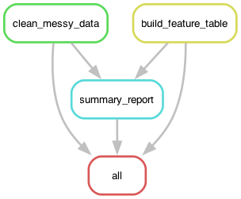

# LAB 5 PUBH6854

This workflow turns the cleaning script from Lab 3 and the 
feature-table script from Lab 4 into one pipeline via **Snakemake 9.24.0**

## Pipeline 



| Stage | Rule | Inputs (all declared) | Outputs |
|---|---|---|---|
| 1. Clean messy data (Lab 3) | `clean_messy_data` | `data/raw/messy_samples.csv`, `data/raw/messy_sequences.fasta`, `scripts/clean_messy_data.R` | `data/processed/clean_samples.csv` (+ sequences, samples×features, feature metadata) |
| 2. Query cohort.db (Lab 4) | `build_feature_table` | `data/cohort.db`, `scripts/build_feature_table.py` (SQL is inside the script) | `output/feature_table.tsv` |
| 3. Summary report | `summary_report` | `clean_samples.csv`, `feature_table.tsv`, `scripts/make_report.py` | `output/report/summary_report.md`, `output/report/summary_figure.png` |

Stage 1 and 2 do not share any files so they are independent branches, Snakemake
can run them in parallel (snakemake --cores 2). Both stages feed into the summary report. 
`rule all` asks for the two tables directly since they are teh outputs of the lab. 

Every Script is listed under `input:` so editing any of the scripts only re-runs that step and the
steps downstream. 

The scripts from Lab 3 and 4 read and write fixed relative paths, written in each script. The Snakefile's paths match 
them exactly, so the workflow can be run fromt he repo's root. 

The "merge into a combined table" step was removed from the assignment so the pipeline 
has three stages and the report summarizes both tables side by side. 


##  Setup 

Requires Git and conda (or mamba) 
``` bash
git clone https://github.com/madsubra19/LAB-5_PUBH6854.git
cd LAB-5_PUBH6854
conda env create -f environment.yml
conda activate lab5
snakemake --version
```
Creating the environment from the `environment.yml` installs 
Python, Snakmake, R, tidyverse, lubridate, and Biostrings. 

## Usage
Run all the commands from the repo root

### Dry Run
This lists the jobs and rhe reason for each job without running anything 
```bash
snakemake -n
```

###  Full Run

```bash
snakemake --delete-all-output --cores 1
snakemake --cores 1
```
`--delete-all-output` removes only files the Snakefile declares as outputs.
Raw data and scripts are never touched. 
A clean run is 4 jobs: `clean_messy_data`, `build_feature_table`, `summary_report`, `all`.

###  Partial Re-run 
Change 1 upstream input
```bash
echo "# partial rerun demo" >> scripts/build_feature_table.py
snakemake -n
snakemake --cores 1
```
Only `build_feature_table, summary_report, and all` re-run (3 jobs).
`clean_messy_data` does not re-run, because nothing it depends on changed. Each
re-run job comes with a `reason:` line naming the edited script.

###  Draw the DAG
```bash
snakemake --rulegraph | dot -Tpng > evidence/rulegraph.png
snakemake --dag | dot -Tpng > evidence/dag.png
```

## Evidence

The evidence files were made with these commands (`tee` saves the console output to a file):

```bash
snakemake --delete-all-output --cores 1
snakemake --cores 1 2>&1 | tee evidence/01_clean_run.txt
snakemake -n 2>&1 | tee evidence/02_no_change.txt
echo "# partial rerun demo" >> scripts/build_feature_table.py
snakemake -n 2>&1 | tee evidence/03_partial_dryrun.txt
snakemake --cores 1 2>&1 | tee evidence/04_partial_run.txt
```

| File | Shows |
|---|---|
| `evidence/01_clean_run.txt` | full run after deleting all outputs: 4 of 4 steps done |
| `evidence/02_no_change.txt` | immediate re-check: "Nothing to be done" |
| `evidence/03_partial_dryrun.txt` | dry run (`snakemake -n`) after editing the Lab 4 script: 3 jobs, with `reason:` lines, and `clean_messy_data` not listed |
| `evidence/04_partial_run.txt` | the actual partial re-run: 3 of 3 steps done, `clean_messy_data` skipped |
| `evidence/rulegraph.png`, `evidence/dag.png` | the workflow DAG |


