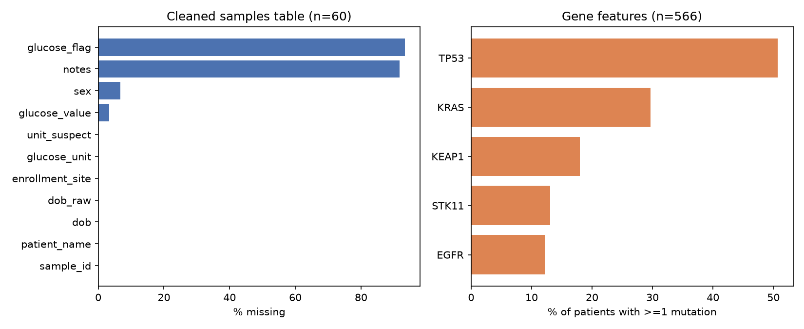

# Lab 5 summary report

_Made by the Snakemake workflow on 2026-11-17 15:44._

Inputs: `data/processed/clean_samples.csv` (Lab 3) and `output/feature_table.tsv` (Lab 4).

## Cleaned samples table (from messy_samples.csv)

- Rows: **60**
- Columns: **11**

### Columns and missingness

| column | dtype | pct_missing |
|---|---|---|
| sample_id | str | 0 |
| patient_name | str | 0 |
| dob | str | 0 |
| dob_raw | str | 0 |
| sex | str | 6.7 |
| enrollment_site | str | 0 |
| glucose_value | float64 | 3.3 |
| glucose_unit | str | 0 |
| notes | str | 91.7 |
| glucose_flag | str | 93.3 |
| unit_suspect | bool | 0 |

### Numeric columns

| column | count | mean | std | min | max |
|---|---|---|---|---|---|
| glucose_value | 58 | 162 | 52 | 74.9 | 249 |

## Patient feature table (from cohort.db)

- Rows: **566**
- Columns: **11**

### Columns and missingness

| column | dtype | pct_missing |
|---|---|---|
| patient_id | str | 0 |
| sex | str | 9.2 |
| age_at_diagnosis | float64 | 12.5 |
| stage | str | 9.5 |
| tissue_source_site | str | 0 |
| tmb_nonsynonymous | float64 | 0 |
| TP53 | int64 | 0 |
| KRAS | int64 | 0 |
| EGFR | int64 | 0 |
| STK11 | int64 | 0 |
| KEAP1 | int64 | 0 |

### Numeric columns

| column | count | mean | std | min | max |
|---|---|---|---|---|---|
| age_at_diagnosis | 495 | 65.3 | 10.1 | 33 | 88 |
| tmb_nonsynonymous | 566 | 10 | 10.7 | 0 | 69.5 |
| TP53 | 566 | 0.539 | 0.559 | 0 | 2 |
| KRAS | 566 | 0.304 | 0.475 | 0 | 2 |
| EGFR | 566 | 0.15 | 0.438 | 0 | 3 |
| STK11 | 566 | 0.143 | 0.384 | 0 | 2 |
| KEAP1 | 566 | 0.182 | 0.391 | 0 | 2 |
